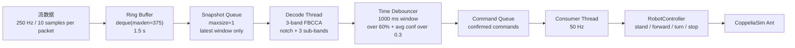
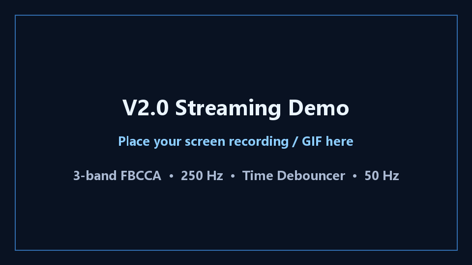

# 从离线到实时：基于 SSVEP 的脑控六足机器人系统演进

> 从离线 CCA 解码到 250 Hz 实时流式闭环，完整记录一个可复现的 SSVEP-BCI × 六足机器人系统。


---

## 1. 项目简介

本项目以 Wang et al. (2016) 的 SSVEP benchmark 为数据源，选取 4 个指令目标：

| 指令 | Event ID | 刺激频率 | 机器人动作 |
|---|---:|---:|---|
| 前进 | 1 | 8.0 Hz | `forward` |
| 左转 | 6 | 13.0 Hz | `turn_left` |
| 右转 | 11 | 10.2 Hz | `turn_right` |
| 停止 | 16 | 15.2 Hz | `stop` |

系统从 **V1.0 离线 trial 级闭环** 演进到 **V2.0 250 Hz 实时流式闭环**，重点解决三个问题：

1. 离线解码模型如何真正接入连续数据流；
2. 滑动窗口滤波与 CCA 计算如何不阻塞 50 Hz 机器人控制；
3. 不稳定的 EEG 意图如何通过时间窗防抖变成安全、稳定的动作。

---

## 2. V1.0 vs V2.0

| 维度 | V1.0 离线闭环 | V2.0 实时流式闭环 |
|---|---|---|
| 解码算法 | CCA | **3-band FBCCA** |
| 四分类准确率 | **97.92%（47/48）** | **100%（48/48，小样本）** |
| 数据模式 | 预切 1.5 s trial | **250 Hz 连续流 + 1.5 s 滑动窗口** |
| 解码节奏 | 约 1.5 s/trial | **每 200 ms 一次** |
| 单次预测耗时 | 6.12 ms/trial | 18.81 ms/window（3-band） |
| 防抖 | 5 帧投票，≥3 票，1.5 s 冷却 | **1000 ms 时间窗，>60%，平均置信度>0.3，1.5 s 锁定** |
| 并发 | 生产者/消费者 | **Stream / Decode / Consumer 三线程 + 有界队列** |
| 机器人 | 18 关节运动学 Ant | 同左，保留 5 步行走与 IK target 解除 |

> 100% 只代表当前 S1 + S2 的 48 个 trial，不能直接等同于泛化精度；它的价值在于验证完整链路和 3-band 消融结论。

---

## 3. V2.0 三线程实时架构



### 3.1 流数据模拟

`streaming_loop.py` 把 S1.mat 的 24 个 trial 拼成连续 8 通道 Raw，默认每 40 ms 推入 10 个采样点：

```text
250 Hz equivalent
    → deque(maxlen=375)   # 最近 1.5 s
    → 每 50 个点（200 ms）取一次滑动窗口
```

### 3.2 实时滤波

不使用 MNE 离线流水线，模块加载时预计算：

```python
NOTCH_B, NOTCH_A = iirnotch(50.0, 30.0, fs=250)
SUB_BAND_SOS = tuple(
    butter(4, [lo, hi], btype="bandpass", fs=250, output="sos")
    for lo, hi in ((6, 90), (14, 90), (22, 90))
)
```

每个窗口：

```python
x = filtfilt(NOTCH_B, NOTCH_A, x, axis=1)
for sos in SUB_BAND_SOS:
    band = sosfiltfilt(sos, x, axis=1)
    label, scores = cca.cca_classify(band, ...)
```

单窗口实测约 **20–25 ms**，远小于 200 ms 决策周期。

### 3.3 时间窗防抖

```text
最近 1000 ms:
  同一标签占比 > 60%
  该标签平均置信度 > 0.30
  至少 5 个有效窗口（启动保护）
        ↓
  确认指令，清空窗口，锁定 1.5 s
```

这替代了 V1.0 的“按次数投票”，避免在 200 ms 高频输出下过快确认。

---

## 4. 消融实验与算法权衡

在 S1 + S2 共 48 trial 上实测（预测耗时已排除 warm-up）：

| Method | Accuracy | Correct/Total | Avg prediction/trial | Total prediction |
|---|---:|---:|---:|---:|
| CCA | 97.92% | 47/48 | 6.12 ms | 0.2937 s |
| FBCCA (5 bands, standard) | 95.83% | 46/48 | 30.79 ms | 1.4781 s |
| **FBCCA (3 bands)** | **100.00%** | **48/48** | **18.81 ms** | **0.9028 s** |
| FBCCA (5 bands, low-weight) | 97.92% | 47/48 | 30.77 ms | 1.4769 s |

分被试：

| Method | S1 | S2 |
|---|---:|---:|
| CCA | 100.00% | 95.83% |
| FBCCA (5 bands, standard) | 100.00% | 91.67% |
| FBCCA (3 bands) | 100.00% | 100.00% |
| FBCCA (5 bands, low-weight) | 100.00% | 95.83% |

### 核心结论：高频子带引入噪声

- 38–90 Hz、30–90 Hz 子带对 8–15.2 Hz SSVEP 基频贡献很小，却会把 EMG、电极接触噪声和运动伪迹带入 CCA；
- S2 的高频谐波信噪比更低，5-band 标准 FBCCA 从 24/24 掉到 22/24；
- 提高低频权重（low-weight）只能把 S2 拉回 95.83%，因为坏子带仍在参与融合；
- 去掉最高频两个子带（3-band）后，S2 回到 100%，同时耗时从 5.03× 降到 3.07× CCA。

> 工程结论：filter bank 不是越多越好。每个子带都需要证明“信息增益 > 噪声增益”。

---

## 5. Demo 演示



> 占位 GIF 已放在 `docs/assets/demo.gif`。
> 录制 V2.0 实时 Demo 后，直接替换同名文件即可。
>
> 建议画面：左侧终端实时滚动 `[流式解码] -> [时间防抖] -> [下发]`，右侧 CoppeliaSim Ant 执行动作。

---

## 6. 如何复现

### 6.1 环境

```powershell
git clone <your-repo-url>
cd bci-quadruped-bci-system

conda create -n bci-quadruped python=3.10 -y
conda activate bci-quadruped
pip install -r requirements.txt
```

### 6.2 数据

由于 `data/*.mat` 不进入 Git，需要把数据放到：

```text
data/S1.mat
data/S2.mat
```

数据形状应为：

```text
(channels=64, samples=1500, targets=40, blocks=6)
```

### 6.3 打开仿真场景

启动 **CoppeliaSim 4.7 EDU**，打开：

```text
scenes/my_robot_debugged.ttt
```

确认 ZMQ Remote API 端口：

```text
23000
```

### 6.4 Stage 1：离线解码与对比

```powershell
python src\stage1_decoders\cca_decoder.py
python src\stage1_decoders\fbcca_decoder.py --bands 3
python src\stage1_decoders\compare_acc.py
```

### 6.5 Stage 2：机器人控制

```powershell
python src\stage2_control\kinematic_gait.py --inspect
python src\stage2_control\kinematic_gait.py --stand-only
python src\stage2_control\kinematic_gait.py --walk-steps 5
```

### 6.6 Stage 3：实时流式闭环

```powershell
# 不连接 CoppeliaSim，先验证线程 / 队列 / 时间防抖
python src\stage3_closed_loop\streaming_loop.py --dry-run --max-seconds 20

# 真正驱动 Ant
python src\stage3_closed_loop\streaming_loop.py --max-seconds 60
```

> 完整 24 trial 约 144 s；若想覆盖到 `stop`，把 `--max-seconds` 调到
> `150` 左右。

---

## 7. 项目结构

```text
bci-quadruped-bci-system/
├─ README.md                     # 本文件
├─ requirements.txt
├─ .gitignore
├─ src/
│  ├─ stage1_decoders/
│  │  ├─ cca_decoder.py
│  │  ├─ fbcca_decoder.py
│  │  └─ compare_acc.py
│  ├─ stage2_control/
│  │  ├─ kinematic_gait.py
│  │  └─ dynamic_gait.py
│  └─ stage3_closed_loop/
│     ├─ step3_closed_loop.py
│     └─ streaming_loop.py
├─ scenes/
│  ├─ my_robot_debugged.ttt
│  ├─ my_robot_debugged_walk_ok_20261108.ttt
│  └─ my_robot_before_debug.ttt
├─ docs/
│  ├─ ant_manual.md
│  ├─ v1.0_manual.md
│  ├─ v1.0_README.md
│  ├─ v2.0_README.md
│  └─ assets/
│     ├─ demo.gif
│     ├─ demo_poster.png
│     ├─ step2_ant_stand_result.png
│     ├─ step2_ant_stand_closeup.png
│     ├─ confusion_matrix.png
│     ├─ window_vs_accuracy.png
│     └─ fbcca_confusion_matrix*.png
├─ archive/
│  └─ v1.0_offline/
│     ├─ step1_cca_decode.py
│     ├─ step2_robot_control.py
│     └─ step3_closed_loop.py
└─ data/
   └─ .gitkeep                  # 本地放 S1.mat / S2.mat，Git 不提交
```

---

## 8. 工程亮点

- **SSVEP 解码**：MNE 预处理 + 手写 CCA / 3-band FBCCA，后枕区 8 通道降维；
- **算法权衡**：用 S1+S2 消融证明“高频子带引入噪声”，3-band 反而更准更快；
- **实时流式**：250 Hz 数据 -> Ring Buffer -> 200 ms 滑动窗口 -> scipy 实时滤波；
- **异步解耦**：Stream / Decode / Consumer 三线程，CCA 不阻塞 50 Hz 控制；
- **时间防抖**：1000 ms 窗口 + 比例/置信度/启动保护 + 1.5 s 锁定；
- **机器人控制**：18 关节 Ant、Yaw 三角步态、IK target 解除、5 步行走；
- **可复现**：`--inspect` / `--test-motion` / `--unseal` / `--walk-steps` / `--dry-run`。

---

## 9. 文档

| 内容 | 路径 |
|---|---|
| V2.0 完整开发说明 | [`docs/v2.0_README.md`](docs/v2.0_README.md) |
| Ant 调试手册 | [`docs/ant_manual.md`](docs/ant_manual.md) |
| V1.0 使用手册 | [`docs/v1.0_manual.md`](docs/v1.0_manual.md) |
| V1.0 README | [`docs/v1.0_README.md`](docs/v1.0_README.md) |
| V1.0 源码归档 | [`archive/v1.0_offline/`](archive/v1.0_offline/) |

---

## 10. 当前边界

- 数据流来自 S1.mat 的离线回放，不是真实 OpenBCI/BrainProducts 硬件；
- 机器人是运动学仿真，前进使用 `setObjectPosition()` 做视觉位移；
- 100% 为当前 48 trial 小样本结果，需要更多被试和 session 验证；
- `dynamic_gait.py` 仍为 V2.0 的动力学预留模块。

---

> 如果这个项目对你有帮助，欢迎 Star；也欢迎交流 SSVEP-BCI 与机器人闭环的工程实践。
