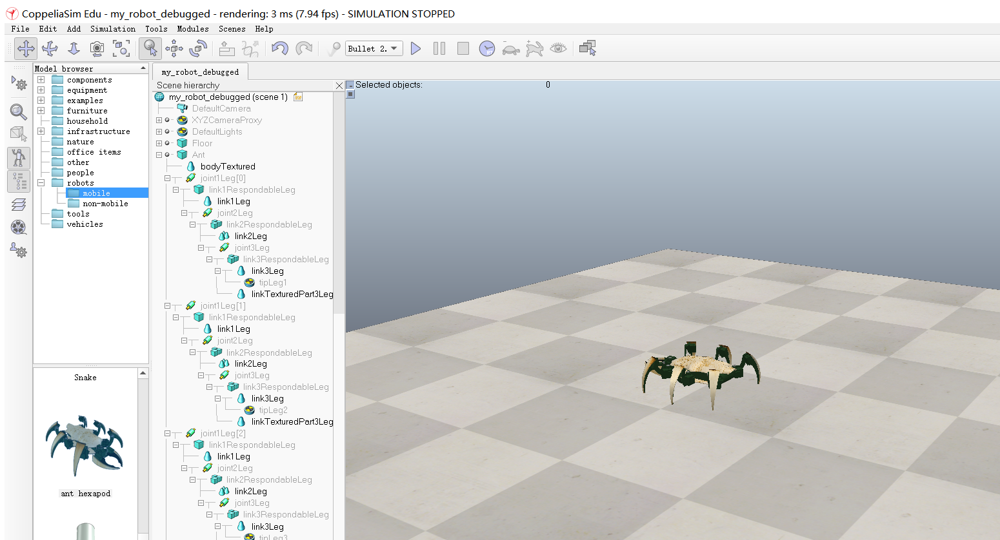

# 阶段 2：CoppeliaSim Ant 六足调试与命令手册

> 适用对象：`src/step2_robot_control.py` + CoppeliaSim 4.7 EDU + Ant 六足模型  
> 当前状态：18 关节站立已稳定；`forward` 已重写为 Ant 专用 **Yaw 三角步态**，5 步行走已验证；异常时按“顺拐/拖地/某腿不动”逐项调参。  
> 最后更新：2026-11-08

## 目录

- [0. 一分钟速查](#0-一分钟速查)
- [1. 文件与职责](#1-文件与职责)
- [2. 启动前检查清单](#2-启动前检查清单)
- [3. 环境与连接命令](#3-环境与连接命令)
- [4. 命令手册](#4-命令手册)
- [5. --inspect 输出怎么读](#5---inspect-输出怎么读)
- [6. Ant 关节配置](#6-ant-关节配置)
- [7. 站立调试流程](#7-站立调试流程)
- [8. 故障排查](#8-故障排查)
- [9. Ant Yaw 三角步态](#9-ant-yaw-三角步态)
- [10. 参数速查](#10-参数速查)
- [11. 场景备份与恢复](#11-场景备份与恢复)
- [12. 最终验收清单](#12-最终验收清单)
- [13. 命令索引](#13-命令索引)
- [14. 已知问题与模型限制](#14-已知问题与模型限制)
- [15. 单关节暴力测试与解除封印](#15-单关节暴力测试与解除封印)
- [16. 阶段 3：闭环联调](#16-阶段-3闭环联调)

---

## 0. 一分钟速查

```powershell
conda activate bci-quadruped
cd D:\bci-quadruped-project

# 1. 只读检查 18 个关节路径
python src\step2_robot_control.py --inspect

# 2. 只启动仿真、保持站立；Ctrl+C 结束
python src\step2_robot_control.py --stand-only

# 3. 向前走 5 个步态周期，然后保持站立
python src\step2_robot_control.py --walk-steps 5

# 4. Yaw 三角步态完整演示（含前进/左转）
python src\step2_robot_control.py
```

当前状态：

- ZMQ 客户端：`coppeliasim-zmqremoteapi-client 2.0.4`
- pyzmq：`27.3.0`
- CoppeliaSim：`4.7.0`
- 端口：`127.0.0.1:23000`
- Ant 腿关节：18 个（另有颈部/颚部 5 个，不参与步态）
- `--inspect`：18/18 `[OK]`
- 站立姿态：已从当前 Ant 模型读取
- forward：**Yaw 三角步态已实现**；建议先 `--stand-only`，再用小步幅测试 forward

### 本次调试结果（2026-11-08）

| 项目 | 结果 |
|---|---|
| 根因 | 站立：57 个 shape 是 dynamic，腿段重力下垂；步态：`targetLeg1..6` IK target 绑定把腿钉住 |
| 修复 | 把所有 shape 设为 Static，并解除 `targetLeg1..6` 的 IK target dummy 绑定；shutdown 恢复 |
| 步态结果 | 六条腿 yaw 全部跟随，`stand -> forward -> turn_left -> stand` 无报错 |
| 5 步行走 | x 从 `-0.503` 到 `-0.707`（约 0.204 m），z 保持 `0.077`，结束站立 |
| 本体 z | 抬高 3 cm 后 `0.0768`，连续 20 步保持不变 |
| 六足端 z | 全部约 `-0.0006`（贴地），不再漂到 0.05~0.07 |
| 关节模式 | 18 个关节 Kinematic |
| 调试场景 | `scenes/my_robot_debugged.ttt` |
| 修复前备份 | `scenes/my_robot_before_debug.ttt` |
| 结果截图 | `docs/step_2.stand/step2_ant_stand_result.png` |



---

## 1. 文件与职责

| 文件 | 作用 |
|---|---|
| `src/step2_robot_control.py` | 六足控制器：连接、关节发现、站立、三角步态、CLI |
| `src/step3_closed_loop.py` | 阶段 3 闭环：模拟解码 + 三层防抖 + 多线程控制 |
| `src/test_zmq_connection.py` | 最小 ZMQ + stepping 连通性测试 |
| `scenes/my_robot_debugged.ttt` | 当前工作场景，已调好站立姿态（本体 z=0.0768） |
| `scenes/my_robot_debugged_walk_ok_20261108.ttt` | 2026-11-08 5 步行走验证版备份（与 debugged 同源） |
| `scenes/my_robot_before_debug.ttt` | 调试前备份（动态 shape，可作原始场景回退） |
| `docs/ant_manual.md` | 本手册 |
| `docs/step_2.stand/step2_ant_stand_result.png` | 站立结果截图 |
| `docs/step_2.stand/step2_ant_stand_closeup.png` | 站立结果局部放大图 |
| `docs/step_2.move/step2_ant_motion_test.mp4` | 单关节 ±45° 测试视频 |
| `docs/step_2.move/step2_ant_walk_5steps.mp4` | 5 步行走测试视频 |

---

## 2. 启动前检查清单

每次重新打开 CoppeliaSim 后，按顺序确认：

- [ ] 只开了一个 CoppeliaSim 实例；
- [ ] 当前激活场景是 `my_robot_debugged.ttt`（应用栏/标题能看到场景名）；
- [ ] 场景左侧 Scene hierarchy 里有 `/Ant`，并且能看到 6 条腿的关节；
- [ ] 仿真处于 **Stopped** 状态（不要点界面上的 Start）；
- [ ] Ant 自带的 simulation script 已禁用/删除；
- [ ] 不需要手动设 Static；控制器会自动设 Static 并解除 6 个 `targetLeg` IK target 绑定，结束后恢复；
- [ ] 18 个腿关节已设为 **Kinematic**（脚本也会尝试设置）；
- [ ] 端口 `23000` 没有被其它程序占用；
- [ ] 当前 Python 环境是 `bci-quadruped`。

> 运动学模式下，关节会动，但物理引擎不会帮你支撑身体。  
> 如果身体还是 dynamic，仿真一开始就可能倒塌、贴地或翻车。

---

## 3. 环境与连接命令

### 3.1 激活环境

```powershell
conda activate bci-quadruped
cd D:\bci-quadruped-project
```

如果 `conda activate` 不可用，直接使用绝对路径：

```powershell
D:\Anaconda3\envs\bci-quadruped\python.exe --version
```

### 3.2 检查客户端版本

```powershell
python -c "import sys, importlib.metadata as m; print(sys.executable); print('client:', m.version('coppeliasim-zmqremoteapi-client'))"
python -m pip show coppeliasim-zmqremoteapi-client
python -m pip check
```

期望：

```text
client: 2.0.4
Name: coppeliasim_zmqremoteapi_client
Version: 2.0.4
```

如果版本不对：

```powershell
python -m pip install --force-reinstall "coppeliasim-zmqremoteapi-client==2.0.4"
```

### 3.3 检查 23000 端口

```powershell
python -c "import socket; s=socket.create_connection(('127.0.0.1',23000),3); print('port 23000 OPEN'); s.close()"
```

如果报 `ConnectionRefusedError`：

1. CoppeliaSim 是否真的启动了；
2. 是否只有一个实例；
3. 场景窗口是否已经出现；
4. 防火墙是否拦截；
5. 是否改过端口（用 `--port` 指定）。

### 3.4 最小 ZMQ + stepping 测试

```powershell
python src\test_zmq_connection.py --timeout 10
```

期望最后看到：

```text
[result] advanced = 0.5000 s over 10 steps
[result][PASS] ZMQ 连接、setStepping 和 sim.step() 均正常。
```

注意：这个脚本会启动/停止当前仿真，先保存场景再跑。

---

## 4. 命令手册

### 4.1 只读检查关节路径

```powershell
python src\step2_robot_control.py --inspect
```

只读行为：

- 不调用 `startSimulation` / `stopSimulation`；
- 不调用 `setStepping` / `step`；
- 不调用 `setJointPosition` / `setJointMode`；
- 不会让机器人动。

如果仿真正在运行，`--inspect` 不会停它；模型自己的脚本仍可能让关节动。  
想完全静止，先在界面点 **Stop**。

### 4.2 只站立调试

```powershell
python src\step2_robot_control.py --stand-only
```

行为：

1. 连接 CoppeliaSim；
2. 停止旧仿真；
3. 开启 stepping；
4. 读取 18 个关节，切换到 kinematic；
5. 把 `/Ant` 下所有 shape 设为 Static，并解除 `targetLeg1..6` 的 IK target 绑定；
6. 捕获当前姿态或使用 `STAND_POSE`；
7. `startSimulation()`；
8. 每个仿真步写入站立角度；
9. `Ctrl+C` 后平滑回站立，然后停止仿真。

注意：这个模式会**真正写关节**，先保存场景。

### 4.3 完整演示（Yaw 三角步态）

```powershell
# 建议先确认 --stand-only 稳定，再用小步幅测试
python src\step2_robot_control.py
```

预期顺序：

```text
stand 2s -> forward 3s -> turn_left 2s -> stand 1s -> stop
```

右转版本：

```powershell
python src\step2_robot_control.py --turn-right
```

### 4.4 手动指定路径

```powershell
python src\step2_robot_control.py --inspect --paths "/Ant/joint1Leg[0],/Ant/joint1Leg[1]"
```

PowerShell 中路径含 `[0]` 时，建议用双引号包住整个字符串。

### 4.5 指定 host / port

```powershell
python src\step2_robot_control.py --inspect --host 127.0.0.1 --port 23000
python src\step2_robot_control.py --stand-only --host 127.0.0.1 --port 23001
```

### 4.6 停止与退出

- `--stand-only`：按一次 `Ctrl+C`，脚本会平滑回站立并 `stopSimulation()`。
- 如果卡住：先在 CoppeliaSim 点 **Stop**，再在终端 `Ctrl+C`。
- 不要直接杀 CoppeliaSim 进程，除非已经保存场景。

### 4.7 重新开始

```powershell
# 关闭当前 Python 脚本（Ctrl+C）
# 在 CoppeliaSim 中停止仿真
# 重新加载/恢复 scenes/my_robot_debugged.ttt
python src\step2_robot_control.py --inspect
python src\step2_robot_control.py --stand-only
```

---

## 5. --inspect 输出怎么读

典型输出：

```text
[env] python : ...
[env] client : coppeliasim-zmqremoteapi-client 2.0.4
[sim] program version: 4.7.0 (raw 40700)
[sim] simulation state: 0
[sim] scene            : ...
[sim] scene objects    : 111
[inspect] checking 18 path(s) from JOINT_PATHS (already filled):
  [OK] /Ant/joint1Leg[0]
  ...
[inspect] JOINT_PATHS mapping (resolved read-only):
  FL: [18, 21, 24]
  ML: [29, 32, 35]
  RL: [40, 43, 46]
  FR: [73, 76, 79]
  MR: [62, 65, 68]
  RR: [51, 54, 57]
[inspect] JOINT_PATHS complete: 6 legs x 3 = 18 handles.
[inspect] total: 23 joints
```

关键判断：

| 输出 | 含义 |
|---|---|
| `JOINT_PATHS complete: 6 legs x 3 = 18 handles` | 18 条路径全部解析成功，可以进入站立调试 |
| `[MISS]` | 某条 path 不对，复制 `all joints` 里的真实 path 替换 |
| `parsed 6 legs x 3 joints mapping: ... MISSING` | Ant 的 `joint1Leg` 名称不含腿编号，名称解析失败是**正常**的；以 `JOINT_PATHS mapping` 为准 |
| `total: 23 joints` | Ant 有 18 个腿关节 + 5 个颈/颚关节；控制器只取 `JOINT_PATHS` 里的 18 个 |
| `scene: (untitled / empty scene)` | 当前场景没有保存文件名；只要 18/18 OK，控制不受影响，但建议另存为 `my_robot_debugged.ttt` |

Handle 是本次 CoppeliaSim 会话的编号，重开场景后可能变化；**路径是稳定的，handle 不是**。

---

## 6. Ant 关节配置

### 6.1 完整 `JOINT_PATHS`

```python
JOINT_PATHS = {
    "FL": [
        "/Ant/joint1Leg[0]",
        "/Ant/joint1Leg[0]/link1RespondableLeg/joint2Leg",
        "/Ant/joint1Leg[0]/link1RespondableLeg/joint2Leg/link2RespondableLeg/joint3Leg",
    ],
    "ML": [
        "/Ant/joint1Leg[1]",
        "/Ant/joint1Leg[1]/link1RespondableLeg/joint2Leg",
        "/Ant/joint1Leg[1]/link1RespondableLeg/joint2Leg/link2RespondableLeg/joint3Leg",
    ],
    "RL": [
        "/Ant/joint1Leg[2]",
        "/Ant/joint1Leg[2]/link1RespondableLeg/joint2Leg",
        "/Ant/joint1Leg[2]/link1RespondableLeg/joint2Leg/link2RespondableLeg/joint3Leg",
    ],
    "FR": [
        "/Ant/joint1Leg[5]",
        "/Ant/joint1Leg[5]/link1RespondableLeg/joint2Leg",
        "/Ant/joint1Leg[5]/link1RespondableLeg/joint2Leg/link2RespondableLeg/joint3Leg",
    ],
    "MR": [
        "/Ant/joint1Leg[4]",
        "/Ant/joint1Leg[4]/link1RespondableLeg/joint2Leg",
        "/Ant/joint1Leg[4]/link1RespondableLeg/joint2Leg/link2RespondableLeg/joint3Leg",
    ],
    "RR": [
        "/Ant/joint1Leg[3]",
        "/Ant/joint1Leg[3]/link1RespondableLeg/joint2Leg",
        "/Ant/joint1Leg[3]/link1RespondableLeg/joint2Leg/link2RespondableLeg/joint3Leg",
    ],
}
```

方括号 `[0]` 原样放在字符串里，`sim.getObject()` 会把它当作重名索引。

### 6.2 腿编号与方位

| 索引 | handle（本次会话） | 世界坐标 (x,y) | 方位 | 代码 |
|---:|---:|---|---|---|
| 0 | 18 | (-0.609, +0.1845) | 前左 | **FL** |
| 1 | 29 | (-0.492, +0.1642) | 中左 | **ML** |
| 2 | 40 | (-0.377, +0.1818) | 后左 | **RL** |
| 3 | 51 | (-0.377, +0.3182) | 后右 | **RR** |
| 4 | 62 | (-0.492, +0.3358) | 中右 | **MR** |
| 5 | 73 | (-0.609, +0.3155) | 前右 | **FR** |

推断依据：

- 头部 `/Ant/neckJoint` 在 `x ≈ -0.630` → 前方是 **-x**；
- `leftJawJoint` 的 y 更小、`rightJawJoint` 的 y 更大 → 左侧是 **-y**，右侧是 **+y**；
- 所以 `[0,1,2]` 是左侧前/中/后，`[5,4,3]` 是右侧前/中/后。

右侧索引是反的：`5=FR, 4=MR, 3=RR`。

### 6.3 三个关节的角色

| 关节 | 局部 z 轴 | 实际角色 | 作用 |
|---|---|---|---|
| `joint1Leg` | 竖直 `(0,0,1)` | **hip yaw** | 腿在水平面内前后摆，是真正的迈步轴 |
| `joint2Leg` | 水平 | **hip pitch** | 抬腿/落腿 |
| `joint3Leg` | 水平 | **knee** | 小腿弯曲 |

> 注意：Ant 的 `joint1Leg` **不是** roll/hip abduction，而是绕竖直轴的 yaw。  
> 当前 `_apply_gait()` 仍按旧的 `[roll,pitch,knee]` 书写，所以 forward 还没适配。

### 6.4 实测站立角度

```python
STAND_POSE = {
    "FL": (-0.5236, +0.0058, +0.4014),
    "ML": ( 0.0000, +0.0058, +0.4014),
    "RL": (+0.5236, +0.0058, +0.4014),
    "FR": (+0.5236, -0.0058, -0.4014),
    "MR": ( 0.0000, -0.0058, -0.4014),
    "RR": (-0.5236, -0.0058, -0.4014),
}
```

顺序是 `[joint1_yaw, joint2_pitch, joint3_knee]`。

左右两侧的 `joint2`、`joint3` 符号是镜像的，不能统一成同一个符号。

### 6.5 `CAPTURE_STAND_POSE`

```python
CAPTURE_STAND_POSE = True   # 默认：启动时捕获模型当前姿态
```

- `True`：启动时读取当前 18 个关节位置作为站立姿态；
- `False`：强制使用 `STAND_POSE` 表；
- 如果模型当前姿态不是站立姿态，设 `False`，用上面的实测表；
- 调参时建议先 `False`，这样每次运行姿态一致。

### 6.6 在 GUI 里查关节路径

1. 左侧 **Scene hierarchy** 展开 `/Ant`；
2. 节点文字是 alias（如 `joint1Leg`、`joint2Leg`）；
3. 完整 path 是父子链：
   ```text
   /Ant/joint1Leg[0]
   /Ant/joint1Leg[0]/link1RespondableLeg/joint2Leg
   ...
   ```
4. 选中关节后，底部 **Commander** 输入：
   ```lua
   sim.getObjectAlias(SEL, 2)
   ```
   返回完整 path；`SEL` 是当前选中对象。
5. 最省事的方法仍然是：
   ```powershell
   python src\step2_robot_control.py --inspect
   ```
   它会直接打印所有真实 path。

---

## 7. 站立调试流程

### 7.1 先确认 18/18

```powershell
python src\step2_robot_control.py --inspect
```

必须看到：

```text
[inspect] JOINT_PATHS complete: 6 legs x 3 = 18 handles.
```

### 7.2 第一次 `--stand-only`

```powershell
python src\step2_robot_control.py --stand-only
```

观察 3-5 秒，重点看：

- 六条腿是否都着地；
- 身体是否水平；
- 是否有一条腿方向明显反了；
- 是否抖动/抽搐；
- 是否劈叉/贴地/翻车。

按 `Ctrl+C` 退出。

### 7.3 一次只改一个参数

不要同时改六个腿。推荐顺序：

1. 先只调 `FL`；
2. 确认 `joint1` / `joint2` / `joint3` 各自让腿怎么动；
3. 再按左右镜像关系同步到其它腿；
4. 每次改动幅度 `0.05 rad` 左右。

关节效果：

| 关节 | 增大角度的大致效果 | 调参用途 |
|---|---|---|
| `joint1` yaw | 腿在水平面内向前/向后扫 | 前后腿张开角度、迈步方向 |
| `joint2` pitch | 整条腿抬起/落下 | 身体高度、脚是否着地 |
| `joint3` knee | 小腿弯曲/伸直 | 膝弯曲程度、脚的位置 |

实际方向可能因左右镜像而相反，以 `--stand-only` 的观察为准。

### 7.4 站立验收标准

- [ ] 六条腿都接触地面；
- [ ] 身体基本水平，没有明显倾斜；
- [ ] 没有腿来回抖动；
- [ ] 没有关节撞限位；
- [ ] `Ctrl+C` 后能平滑回站立并停止仿真；
- [ ] 连续运行 5 秒姿态稳定。

---

## 8. 故障排查

### 8.0 症状速查表

| 症状 | 优先检查 | 快速处理 |
|---|---|---|
| 腿向两侧/前后张太大（劈叉） | 左右映射、`STAND_POSE` 符号、关节限位 | 对调左右三对，或按 6.4 表重新填 |
| 身体贴地、脚陷地板 | 是否进入 Static + targetRelease、`/Ant` 高度 | 确认 `[kinematic] static ... released 6 ...`，抬高本体 |
| 翻车 | 重力/静态属性是否恢复、是否有外部约束 | 重载场景，检查 `RELEASE_IK_TARGETS=True` |
| 关节来回抽搐 | 关节是否 Kinematic、脚本是否禁用、限位 | 手动设 Kinematic，禁用脚本 |
| 某条腿方向反了 | 该腿 joint2/joint3 符号 | 单腿 `±0.05 rad` 测试后取反 |
| 完全不动 | 是否已经在站立姿态、stepping、handle | 看 `[init]` 日志和 18/18 |
| 连接失败 | CoppeliaSim 是否启动、端口、实例数 | 只留一个实例，重开终端 |

### 8.1 劈叉

**现象**：腿向左右或前后张得过大，身体下沉。

检查顺序：

1. **左右映射是否反了**  
   临时把 `JOINT_PATHS` 的 `FL ↔ FR`、`ML ↔ MR`、`RL ↔ RR` 对调，再跑 `--stand-only`。如果明显改善，说明左右推断反了。
2. **`STAND_POSE` 是否用了正确的左右符号**  
   左侧 joint2 是负、joint3 是正；右侧相反。不要复制同一组符号到右侧。
3. **joint1 yaw 的前后角度**  
   FL/RL 的 joint1 是 `-0.5236/+0.5236`；如果前后腿张得太开，减小绝对值。
4. **关节限位**  
   双击关节 → `Joint` → `Limits`，确认目标角度没有超出范围；超出会被夹住，看起来像劈叉。

### 8.2 贴地 / 脚陷进地板

1. 确认控制台出现 `[kinematic] static ... released 6 IK target dummy(s)`；若没有，检查 `/Ant` 路径和 `RELEASE_IK_TARGETS`。
2. 检查 `/Ant` 的 z 高度，必要时整体抬高 1-2 cm；
3. 调 `STAND_POSE` 的 joint2/joint3，让腿稍微伸直或弯曲；
4. 检查脚部 shape 是否和地面碰撞。

### 8.3 翻车

1. 确认 `[kinematic] static ... released 6 IK target dummy(s)`；
2. 降低重心：适当增大 knee 弯曲，或减小 joint2 的抬腿角度；
3. 检查六条腿是否形成稳定支撑面；
4. 检查左右腿是否有一侧方向反了。

### 8.4 抽搐 / 抖动

按顺序检查：

1. 18 个关节是否全部 **Kinematic**；控制台应打印  
   `[mode] all 18 joints set to kinematic.`
2. Ant 的 simulation script 是否全部禁用；
3. 关节 Limits 是否夹住目标；
4. 是否有其它脚本/IK/loop closure 在写关节；
5. `--inspect` 是否显示 18/18；
6. 仿真是否真的在 stepping 模式（看 `[init] stepping mode enabled`）。

### 8.5 腿的方向反了

1. 只选一条腿，设 `CAPTURE_STAND_POSE=False`；
2. 只改这条腿的一个关节 `+0.05 rad`；
3. 跑 `--stand-only`，看腿往哪边动；
4. 如果方向相反，把该关节的符号取反；
5. 左右腿的 joint2/joint3 是镜像的，注意不要直接复制符号。

### 8.6 完全不动

- 如果当前姿态就是站立姿态，`--stand-only` 保持不动是正常的；
- 检查 `[init] stepping mode enabled`；
- 检查 `startSimulation()` 是否成功；
- 检查 18 个 handle 是否有效；
- 检查关节是否被脚本/动力学锁住。

### 8.7 连接失败

```text
ConnectionRefusedError / Again: Resource temporarily unavailable
```

1. CoppeliaSim 是否启动；
2. 是否只有一个实例；
3. 端口是否 23000；
4. 是否被防火墙拦截；
5. 是否上一次 Python 进程还没退出；
6. 重启 CoppeliaSim 和终端。

---

## 9. Ant Yaw 三角步态


Ant 的三个关节是：

```text
joint1 = yaw（前后摆，主推进）
joint2 = pitch（抬腿/落腿）
joint3 = knee（小腿配合弯曲）
```

`_apply_gait()` 已改为：

```text
phase = 2π · GAIT_FREQ · t
Group A = FL, MR, RL : phase + 0
Group B = FR, ML, RR : phase + π

side = +1（左侧 FL/ML/RL），-1（右侧 FR/MR/RR）

yaw   = base_yaw   - side · YAW_SWING  · scale · sin(phase)
lift  = max(0, cos(phase + LIFT_PHASE_OFFSET))
pitch = base_pitch - side · LIFT_AMOUNT · scale · lift
knee  = base_knee  - side · KNEE_BEND   · scale · lift
```

### 9.1 调试口诀

| 现象 | 先调什么 | 方向 |
|---|---|---|
| 整体倒着走 | `YAW_SWING` 取负 | 正负号翻转 |
| 顺拐、左右腿同向摆 | 检查 `side` 是否左 +1、右 -1 | 右侧 yaw 必须取反 |
| 抬腿不明显、拖地 | 增大 `LIFT_AMOUNT` / `KNEE_BEND` | 0.15/0.10 → 0.20/0.15 |
| 抬太高、抽搐 | 减小 `LIFT_AMOUNT` / `KNEE_BEND` | 减半再试 |
| 落地时脚还在往前扫 | `LIFT_PHASE_OFFSET` | 试 `+π/2` / `-π/2`，让抬腿窗口对齐 yaw 前摆 |
| 左转实际右转 | 交换 turn 的左右 scale，或给 `turn_left` 传 -1 | 差速方向 |
| 步频太快/太慢 | `GAIT_FREQ` | 0.8–1.6 Hz |
| 转向幅度太大 | `TURN_STRIDE_GAIN` | 0.2–0.5 |

> 当前 Ant 模型有 target dummy / 闭链结构，实际可视化时如果某条腿不跟随，
> 先在 GUI 里单独选中该腿的 joint1/joint2/joint3，确认 `setJointPosition`
> 能让它动；这是模型约束问题，不是公式问题。

---

## 10. 参数速查

| 参数 | 当前值 | 作用 | 建议范围 |
|---|---:|---|---|
| `CAPTURE_STAND_POSE` | `True` | 捕获当前姿态 | 调参时可用 `False` |
| `MODEL_ROOT` | `/Ant` | 自动准备的模型根 | 换模型时修改 |
| `RELEASE_IK_TARGETS` | `True` | 解除 targetLeg1..6 的 IK target 绑定 | 必须 `True`，否则腿不动 |
| `GAIT_FREQ` | 1.2 | 步态频率 | 0.8–1.6 |
| `YAW_SWING` | 0.28 | joint1 前后摆幅 | 0.15–0.40 |
| `LIFT_AMOUNT` | 0.15 | joint2 抬腿量 | 0.10–0.25 |
| `KNEE_BEND` | 0.10 | joint3 配合弯曲 | 0.05–0.20 |
| `LIFT_PHASE_OFFSET` | 0.0 | 抬腿相位偏移 | 拖地时试 ±π/2 |
| `TURN_STRIDE_GAIN` | 0.35 | 转向差速 | 0.20–0.50 |
| `STOP_DURATION` | 0.5 | 平滑停止时间 | 0.3–1.0 |
| `DEFAULT_DT` | 0.05 | 步长兜底 | 通常不用改 |

三角组：

```text
Group A = FL, MR, RL   phase = 0
Group B = FR, ML, RR   phase = π
```

---

## 11. 场景备份与恢复

当前已验证备份：

```text
scenes/my_robot_debugged_walk_ok_20261108.ttt
```

调参前：

```powershell
Copy-Item "scenes\my_robot_debugged.ttt" "scenes\my_robot_backup.ttt"
```

如果姿态调坏了：

1. CoppeliaSim 中 `Ctrl+Z` 撤销，或
2. `File > Open Scene` 重新加载备份，或
3. 停止仿真后重新打开 `my_robot_debugged.ttt`。

不要在仿真运行时直接改 `STAND_POSE` 并期待立即生效；需要重启 `--stand-only`。

---

## 12. 最终验收清单

- [ ] `--inspect` 18/18 `[OK]`
- [ ] 关节全部 Kinematic
- [ ] Ant 脚本全部禁用
- [ ] 控制台出现 `[kinematic] static ... released 6 IK target dummy(s)`
- [ ] `--stand-only` 稳定 5 秒
- [ ] 六脚着地、身体水平
- [ ] 无抽搐、无劈叉、无翻车
- [ ] 记录最终 `STAND_POSE` 六组值
- [ ] forward 小步幅测试，确认 yaw 推进方向

---

## 13. 命令索引

```powershell
# 环境
conda activate bci-quadruped
cd D:\bci-quadruped-project

# 版本
python -c "import sys, importlib.metadata as m; print(sys.executable); print(m.version('coppeliasim-zmqremoteapi-client'))"
python -m pip show coppeliasim-zmqremoteapi-client
python -m pip check

# 端口
python -c "import socket; s=socket.create_connection(('127.0.0.1',23000),3); print('OPEN'); s.close()"

# ZMQ + stepping
python src\test_zmq_connection.py --timeout 10

# 只读关节检查
python src\step2_robot_control.py --inspect

# 自定义路径检查
python src\step2_robot_control.py --inspect --paths "/Ant/joint1Leg[0],/Ant/joint1Leg[1]"

# 只站立
python src\step2_robot_control.py --stand-only

# Yaw 三角步态完整演示
python src\step2_robot_control.py
python src\step2_robot_control.py --turn-right

# 走 5 个步态周期后站立
python src\step2_robot_control.py --walk-steps 5

# 单关节暴力测试 / 解除封印
python src\step2_robot_control.py --test-motion
python src\step2_robot_control.py --unseal
```

---

## 14. 已知问题与模型限制

### 14.0 问题速查

| 问题 | 现象 | 处理 |
|---|---|---|
| Static shape 不跟关节 | 站立稳，但 forward 腿不动 | 解除 `targetLeg` IK target 绑定（脚本已做） |
| IK target 绑定 | 关节角在变，tip 完全不动 | 解除 `targetLeg` dummytype/linktype |
| forward 整机视觉未完全验证 | 关节角变了，部分足端不动 | 先单腿诊断，再调相位/符号 |
| 运动学不产生真实位移 | 原地迈步 | 后续 `setObjectPosition` 或动力学 |
| `parsed mapping` MISSING | Ant 名称无腿编号 | 以 `JOINT_PATHS mapping` 为准 |
| handle 变化 | 重开场景后编号不同 | 永远填 path |
| 场景 untitled | 连到未命名/空场景 | 另存并激活 `my_robot_debugged.ttt` |
| 异常退出残留 | target-release/stepping | 重载场景，重新 inspect |
| 阶段 3 实时性 | 18 关节 × 每步写 | 解码线程/控制线程分离 |

### 14.1 真正的“封印”：targetLeg IK target dummy

这次问题的根因不是限位、不是幅值，也不是 `_apply_gait()` 公式，而是：

```text
/Ant/legBase/targetLeg1 ... targetLeg6
```

这些 dummy 的 **dummytype = 5、linktype = 5**，属于 **IK 目标**。它们把每条腿的 link 绑在 IK 目标上，导致：

- `sim.setJointPosition()` 能改关节角，`getJointPosition()` 也确实在变；
- 但 `getObjectPosition(tipLegN)` 完全不变；
- GUI 里腿像被钉住一样。

实测：

```text
释放前：
  q: -0.5236 -> -1.1236
  tip: 完全不变

把 targetLeg1..6 的 dummytype/linktype 置 0 后：
  q: -0.5236 -> -1.1236
  tip: (-0.6597, 0.0927) -> (-0.7027, 0.1374)  ✅
```

六条腿同时写 yaw 也能全部跟随：

```text
FL q -0.804  tip d (-0.0234, +0.0176, 0)
ML q -0.280  tip d (-0.0291, +0.0035, 0)
RL q +0.244  tip d (-0.0269, -0.0115, 0)
FR q +0.804  tip d (-0.0234, -0.0176, 0)
MR q +0.280  tip d (-0.0291, -0.0035, 0)
RR q -0.244  tip d (-0.0269, +0.0115, 0)
```

现在 `_prepare_kinematic_model()` 的做法：

```text
所有 /Ant shape -> Static（防重力下坠）
targetLeg1..6 -> dummytype=0, linktype=0（解除 IK target 绑定）
shutdown -> 恢复原 shape static / dummy 类型
```

控制台应看到：

```text
[kinematic] static 57 shapes under /Ant; released 6 IK target dummy(s).
```

### 14.2 如何检查 dummy / 闭链

`--unseal` 会打印：

- `joint mode`
- `joint interval`
- `joint dependency`
- `dynamically enabled`
- `target position`
- 父对象/子树
- `/Ant` 下所有 dummy 的 `dummytype/linktype/linked`

正常 Ant 的结果：

```text
当前（_prepare 已释放）: targetLeg1..6 dummytype=0 linktype=0 linked=-1
原始（saved）:            targetLeg1..6 dummytype=5 linktype=5
dynamic loop closures found: 0
```

`--unseal` 在控制器初始化之后运行，所以列表里看到的是已释放的 0；
`[diag] IK targets released this session` 会打印原始 5/5。

结论：

- **没有动态 loop closure**；
- 绑定来自 **IK 目标 dummy**，不是 IK group 或闭链；
- 把 `targetLeg1..6` 的 `dummyintparam_dummytype` / `dummyintparam_link_type` 置 0 即可释放；
- `headTarget` 不影响腿，可以保留。

如果 `--unseal` 看到 `linked != -1` 或 `dynamic loop closures > 0`，再检查 `sim.getLinkDummy()` 和 IK group；当前 Ant 不是这种情况。

### 14.3 当前验证边界

已经实测通过：

- 18/18 关节路径解析；
- `/Ant` 下 57 个 shape 的 Static 切换；
- 抬高后站立：本体 z=0.0768，六足端约 -0.0006，20 步稳定；
- FL/FR 的 joint1/joint2/joint3 正负方向与 Yaw 步态公式一致；
- 解除 6 个 `targetLeg` IK target 后，**六条腿的 yaw 全部跟随**；
- 完整 `stand -> forward -> turn_left -> stand` 无报错；
- 单关节 ±45° 暴力测试 tip 跟随，已录制视频：
  `docs/step_2.move/step2_ant_motion_test.mp4`

尚未完全验证：

- 实际位移/转向角度是否与步态参数成比例；
- 长时间运行的稳定性；
- 不同步幅/频率下的最优参数。

所以第一次跑 forward 时，请用**小步幅**并逐条腿观察，不要直接认为“参数越大越好”。

### 14.4 运动学模式不会让本体真的平移

- 本体是 Static，`sim.setJointPosition` 只改变关节角；
- 视觉上是“原地迈步”，不是真正在地面上前进；
- 如果要让机身真的移动，后续对 `/Ant` 本体调用 `sim.setObjectPosition()` 做开环位移，或者恢复动力学/使用真正的 locomotion controller。

### 14.5 `--inspect` 的 `parsed mapping` 显示 MISSING 是正常的

Ant 的关节名是：

```text
joint1Leg / joint2Leg / joint3Leg
```

它们**不含 FL/ML/RL/FR/MR/RR 腿编号**，名称解析无法知道 `joint1Leg` 属于哪条腿。  
所以 `--inspect` 里的：

```text
parsed 6 legs x 3 joints mapping:
  FL: joint1_yaw=MISSING ...
```

是正常的。以：

```text
[inspect] JOINT_PATHS mapping (resolved read-only):
  FL: [17, 20, 23]
  ...
```

为准。`JOINT_PATHS` 已填好，18/18 全部 `[OK]` 就说明路径正确。

### 14.6 handle 每次重开场景会变

- `handle` 是本次 CoppeliaSim 会话的编号；
- 重开场景后 handle 可能从 `18/21/24` 变成 `17/20/23`；
- **路径**（`/Ant/joint1Leg[0]` 等）是稳定的；
- 所以永远填路径，不要把 handle 写死。

### 14.7 场景名显示 untitled

`--inspect` 里可能看到：

```text
[sim] scene : (untitled / empty scene)
```

只要 18/18 `[OK]` 且能看到 Ant，控制不受影响。  
但建议在 CoppeliaSim 里 `File > Save Scene As` 保存为：

```text
scenes/my_robot_debugged.ttt
```

这样下次不会连错场景。

### 14.8 异常退出后的恢复

`shutdown()` 会恢复：

- 原 shape 的 static 属性；
- `targetLeg1..6` 的 dummytype/linktype；
- 停止仿真、关闭 stepping。

如果 Python 进程被强制杀死，可能留下：

- shape 仍为 Static、但 targetLeg IK target 绑定未恢复；
- 或 stepping 层级残留。

恢复方法：

1. CoppeliaSim 中停止仿真；
2. 重新加载 `scenes/my_robot_debugged.ttt`；
3. 重新运行 `--inspect` 确认 18/18；
4. 再运行 `--stand-only`。

不要在仿真运行时保存场景，否则可能把 target-release/临时状态写进 `.ttt`。

### 14.9 阶段 3 实时闭环的注意点

当前控制循环每步要写 18 个关节（18 次 ZMQ 调用）+ 1 次 `sim.step()`。  
阶段 3 把 CCA 解码接进来时：

- 控制频率先按 20–50 Hz 评估；
- 不要在每次 step 里做完整 CCA（1.5 s 窗口、4 类、3 谐波）；
- 建议用“解码线程 + 控制线程”或固定决策周期（例如每 200 ms 更新一次指令）；
- 当前 Static + target-release 运动学模式只适合视觉/闭环逻辑验证，不是真实的动力学行走。

---

## 15. 单关节暴力测试与解除封印

### 15.1 两个新命令

```powershell
# 只诊断/尝试解除 FL joint1 的限位与 IK target 绑定
python src\step2_robot_control.py --unseal

# 让 FL joint1 在 ±45° 之间来回摆，默认 6 秒
python src\step2_robot_control.py --test-motion

# 自定义：ML 的 joint2，±30°，周期 2 秒，跑 8 秒
python src\step2_robot_control.py --test-motion `
  --test-leg ML --test-index 1 `
  --test-amplitude 30 --test-period 2 --test-duration 8
```

参数：

| 参数 | 默认 | 说明 |
|---|---:|---|
| `--test-leg` | `FL` | `FL/ML/RL/FR/MR/RR` |
| `--test-index` | `0` | `0=yaw`, `1=pitch`, `2=knee` |
| `--test-amplitude` | `45` | 角度制振幅 |
| `--test-period` | `1.0` | 一个来回的秒数 |
| `--test-duration` | `6` | 测试持续秒数 |

### 15.2 `--unseal` 会打印什么

- `joint mode`：应为 `(0, 0)` = kinematic；
- `joint interval`：Ant 的 joint1 是 `(True, [-π, 2π])`，**本来就是 cyclic，没有锁死**；
- `joint dependency`：应为 `(-1, 0.0, 1.0)`；
- `dynamically enabled`：应为 `False`；
- 父对象/子树：确认 link 确实挂在 joint 下；
- `/Ant` 下所有 dummy 的 `dummytype/linktype/linked`；
- `dynamic loop closures found`：当前 Ant 为 `0`。

尝试解除：

```text
sim.setJointInterval(h, cyclic=True, [0,0])
sim.setJointMode(h, kinematic, 0)
sim.setJointPosition(h, 0)
```

诊断结束会自动恢复原关节角和 interval，避免把 0° 姿态带给下一次
`CAPTURE_STAND_POSE`。

### 15.3 `--test-motion` 会打印什么

```text
[test-motion] t= 1.05s  cmd=+0.243  actual=+0.243  tip=(-0.582,+0.083,-0.001)
[test-motion] t= 3.15s  cmd=+0.635  actual=+0.635  tip=(-0.545,+0.101,-0.001)
[test-motion] t= 4.25s  cmd=+0.785  actual=+0.785  tip=(-0.533,+0.112,-0.001)
[test-motion] done. command/actual mismatch frames: 0
```

判断标准：

| 输出 | 含义 |
|---|---|
| `actual` 不跟 `cmd` | 关节模式/限位/依赖问题 |
| `actual` 跟 `cmd`，`tip` 不变 | link 被 IK target/闭链绑住 |
| `actual` 和 `tip` 都变 | 该关节链路正常 |

### 15.4 实测结论（关键）

**释放前：**

```text
cmd/actual 在 ±45° 完全跟随
tip 6 秒内完全不变
```

**把 `targetLeg1..6` 的 `dummytype/linktype` 置 0 后：**

```text
q: -0.5236 -> -1.1236
tip: (-0.6597, 0.0927) -> (-0.7027, 0.1374)
```

六条腿同时写 yaw 也全部跟随：

```text
FL q -0.804  tip d (-0.0234, +0.0176, 0)
ML q -0.280  tip d (-0.0291, +0.0035, 0)
RL q +0.244  tip d (-0.0269, -0.0115, 0)
FR q +0.804  tip d (-0.0234, -0.0176, 0)
MR q +0.280  tip d (-0.0291, -0.0035, 0)
RR q -0.244  tip d (-0.0269, +0.0115, 0)
```

完整 `stand -> forward -> turn_left -> stand` 已无报错，本体 z 保持 `0.0768`。

### 15.5 代码里对应的修复

`_prepare_kinematic_model()`：

```text
所有 /Ant shape -> Static
targetLeg1..6 -> dummytype=0, linktype=0
shutdown -> 恢复 shape static 与 dummy 类型
```

控制台必须出现：

```text
[kinematic] static 57 shapes under /Ant; released 6 IK target dummy(s).
```

如果 `released` 不是 6：

1. 确认 `/Ant/legBase/targetLeg1..6` 存在；
2. 确认 `RELEASE_IK_TARGETS=True`；
3. 用 `--inspect` 确认场景里是 Ant，不是空场景。

### 15.6 测试视频

单关节 ±45° 暴力测试录像：

- `docs/step_2.move/step2_ant_motion_test.mp4`

视频里 FL 的 joint1 在 ±45° 来回摆，足端随之移动。

### 15.7 5 步行走测试

```powershell
# 走 5 个完整步态周期，然后保持站立
python src\step2_robot_control.py --walk-steps 5
```

参数：

| 参数 | 默认 | 说明 |
|---|---:|---|
| `--walk-steps` | `0` | 走 N 个完整步态周期；0 = 不触发 |
| `--walk-body-step` | `0.04` | 每个周期本体的视觉前进量（米） |

实测（2026-11-08）：

```text
[walk] forward 5 cycle(s), cycle=0.833s, body_step=0.040m
[walk] cycle 1/5  body=(-0.544,+0.250,+0.077)
[walk] cycle 2/5  body=(-0.585,+0.250,+0.077)
[walk] cycle 3/5  body=(-0.625,+0.250,+0.077)
[walk] cycle 4/5  body=(-0.666,+0.250,+0.077)
[walk] cycle 5/5  body=(-0.707,+0.250,+0.077)
[walk] done; holding stand pose.
```

- 前进约 `0.204 m`；
- 本体 z 始终 `0.077`；
- 结束后关节回到 `STAND_POSE` 并保持站立。

录像：

- `docs/step_2.move/step2_ant_walk_5steps.mp4`

> 说明：本体是 Static，`--walk-steps` 里的前进是用
> `sim.setObjectPosition()` 做的**同步视觉位移**，不是物理摩擦推进；
> 关节步态仍由 `_apply_gait()` 驱动。若只想原地迈步，用
> `--walk-body-step 0`。

---

## 16. 阶段 3：闭环联调

脚本：

```text
src/step3_closed_loop.py
```

它把 Stage 1 的 CCA 解码、Stage 2 的 Ant 控制接起来：

```text
S1.mat -> 每 1.5 s 解码一个 trial -> Debouncer -> queue.Queue
       -> 50 Hz consumer -> RobotController
```

### 16.1 运行

```powershell
# 只验证线程/队列/防抖，不启动 CoppeliaSim
python src\step3_closed_loop.py --dry-run --max-seconds 20

# 真正驱动 Ant；默认最长 90 s
python src\step3_closed_loop.py

# 快速测试：缩短 trial 间隔
python src\step3_closed_loop.py --trial-interval 0.5 --max-seconds 25
```

### 16.2 三层防抖

`Debouncer` 的顺序是：

1. **置信度过滤**：最高相关系数 `< 0.30` -> `忽略（低置信度）`，
   不进入投票窗口；
2. **滑动窗口投票**：最近 5 个有效结果中同一指令 `>= 3` 次才确认；
3. **冷却锁定**：确认输出后冷却 1.5 s，冷却期间不再响应。

确认后才把 `forward / turn_left / turn_right / stop` 放进
`queue.Queue`；原始解码不会直接驱动机器人。

### 16.3 终端输出

```text
[原始解码] 前进 (0.85) -> [防抖状态] 投票中（1/5，前进×1） -> [下发指令] —
[原始解码] 前进 (0.24) -> [防抖状态] 忽略（低置信度 0.24） -> [下发指令] —
[原始解码] 左转 (0.65) -> [防抖状态] 确认（左转 3/5） -> [下发指令] 左转
[机器人] 切换动作 -> 左转
```

### 16.4 参数

| 参数 | 默认 | 说明 |
|---|---:|---|
| `--trial-interval` | 1.5 | 每个 trial 的间隔秒数 |
| `--max-seconds` | 90 | 最长运行时间，防止没有 stop |
| `--confidence-threshold` | 0.30 | 低置信度阈值 |
| `--window` | 5 | 投票窗口 |
| `--majority` | 3 | 确认票数 |
| `--cooldown` | 1.5 | 冷却秒数 |
| `--seed` | 42 | 误识别/走神模拟种子 |
| `--dry-run` | 关 | 不连接 CoppeliaSim |

模拟噪声：

- 10% 概率随机翻转 label；
- 15% 概率把 confidence 改成 `0.10~0.29`，模拟走神。

### 16.5 stop 与退出

防抖确认 `stop` 后，consumer 调用 `controller.stop()` 平滑回到
`STAND_POSE`，再调用 `shutdown()` 恢复 shape/IK target 属性。
如果一直没有确认 stop，`--max-seconds` 到点后也会安全退出并站立。
