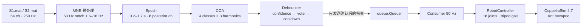
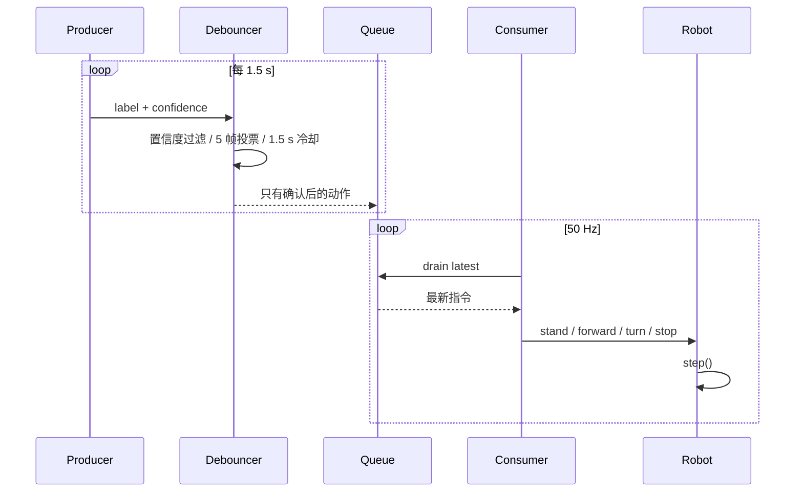
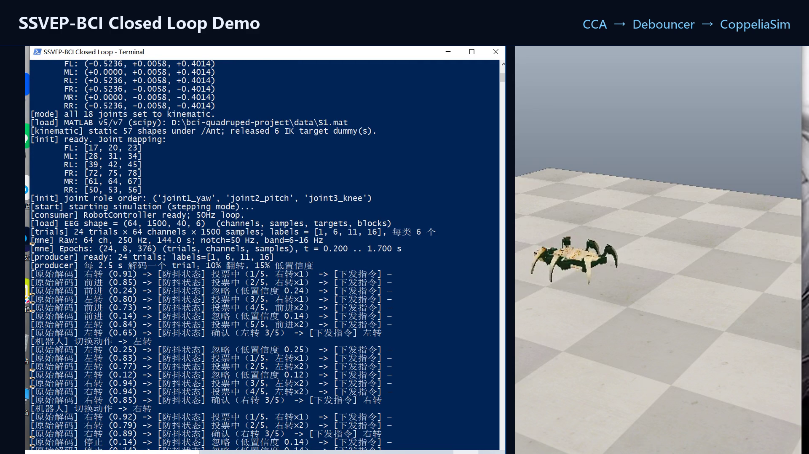

# SSVEP-BCI 六足机器人闭环控制系统

> 用 4 类 SSVEP 脑电指令驱动 CoppeliaSim Ant 六足机器人，打通「离线 EEG 解码 → 三层防抖 → 50 Hz 运动学控制」的完整闭环。
>
> 第一次使用请看 [`GUIDANCE.md`](v1.0_manual.md)；深度调试看 [`docs/ant_manual.md`](ant_manual.md)。


---

## 1. 项目背景

非侵入式脑机接口（BCI）的核心挑战不是“离线分类准确率”，而是**把不稳定的脑电信号变成机器人可以安全执行的连续指令**。

本项目以 Wang et al. (2016) 的 40-target SSVEP benchmark 为数据源，选取 4 个指令目标，构建一条可复现的闭环链路：

| 指令 | Event ID | 刺激频率 | 机器人动作 |
|---|---:|---:|---|
| 前进 | 1 | 8.0 Hz | `forward` |
| 左转 | 6 | 13.0 Hz | `turn_left` |
| 右转 | 11 | 10.2 Hz | `turn_right` |
| 停止 | 16 | 15.2 Hz | `stop` / 平滑站立 |

目标不是做一次“跑通就结束”的 demo，而是把**解码、防抖、线程调度、机器人运动学**拆成可解释、可调试、可复现的工程模块。

---

## 2. 核心成果

| 模块 | 结果 |
|---|---|
| SSVEP 四分类（S1 + S2） | **97.92%（47/48）**，1.5 s 窗口，3 谐波 CCA |
| 时间窗分析 | 0.5 / 1.0 / 1.5 / 2.0 s → **39.58% / 81.25% / 97.92% / 100%** |
| 六足模型 | Ant，**18 个腿关节**（6 腿 × 3 关节）+ 5 个颈部/颚部关节 |
| 站立姿态 | 本体 `z = 0.0768 m`，六足端 `z ≈ -0.0006 m`，20 步稳定 |
| Yaw 三角步态 | 六条腿全部跟随，5 个步态周期前进 **0.204 m**，结束回到站立 |
| 闭环控制 | 解码约 **0.67 Hz**（1.5 s/帧），机器人控制 **50 Hz**，队列解耦 |
| 防抖 | 置信度阈值 0.30 + 5 帧投票（≥3）+ 1.5 s 冷却 |
| 调试工具 | `--inspect` / `--stand-only` / `--test-motion` / `--unseal` / `--walk-steps` |

---

## 3. 系统架构



### 3.1 两个时间尺度



**为什么用队列解耦：** CCA/MNE 是低频重计算，单帧耗时可能几十到几百毫秒；机器人控制是 50 Hz 轻量循环。如果放在同一线程，每次 CCA 都会让机器人停顿。`queue.Queue` 把两条时间线隔开：生产者只生产防抖后的指令，消费者只取最新指令，队列吸收解码抖动，双方不共享动作状态。

---

## 4. 核心算法：CCA

### 4.1 预处理

- 50 Hz 工频陷波；
- 6–16 Hz 带通，保留 8–15.2 Hz 基频及其谐波；
- 刺激后 **0.2–1.7 s** 截取 1.5 s 窗口；
- CCA 只使用后枕区 8 通道：`PO7, PO3, POz, PO4, PO8, O1, Oz, O2`。

> 全 64 通道直接做 CCA 会因通道高度共线导致协方差矩阵条件数爆炸；后枕区降维是精度和数值稳定性的关键。

### 4.2 典型相关分析

给定 EEG 矩阵 `X`（通道 × 时间）和参考信号 `Y`（sin/cos 谐波），CCA 寻找投影 `w_x, w_y`，最大化：

```text
max  corr(X·w_x, Y·w_y)
```

参考信号包含基频及 3 次谐波，以覆盖视觉皮层的非线性响应。对每个候选频率计算最大典型相关系数，取最大者作为预测标签；该最大值同时作为**置信度**。

### 4.3 为什么置信度不是分类概率

CCA 输出的是“EEG 与模板的线性相关强度”，不是 softmax 概率。低相关可能意味着用户走神、眨眼、电极阻抗变差或根本没有注视刺激。因此工程上必须有一个 **No-control** 门控，而不是无条件相信 argmax。

---

## 5. 工程亮点

### 5.1 破解 Ant 的 IK Target「封印」

这是本项目最关键的调试发现。

**现象：**

- 18 个关节全部找到，Kinematic 模式设置成功；
- `sim.setJointPosition()` 能改关节角，`getJointPosition()` 也在变；
- 但 CoppeliaSim 里的腿完全不动，足端坐标 6 秒内不变；
- 完整 `stand → forward → turn_left → stand` 无报错，视觉上却像“被钉在墙上”。

**排查：**

- joint interval 是 cyclic，没有限位；
- joint dependency 为 `(-1, 0, 1)`，没有依赖；
- 没有动态 loop closure；
- `/Ant/legBase/targetLeg1..6` 是 IK target dummy（`dummytype=5`、`linktype=5`），把腿绑在目标点上。

**解决：**

- 把所有 `/Ant` shape 设为 Static，防止重力下坠；
- 将 `targetLeg1..6` 的 `dummytype/linktype` 置 0，解除 IK 绑定；
- `shutdown()` 时恢复原 shape 与 dummy 属性；
- 用 `--test-motion` 做 ±45° 单关节暴力测试，确认“关节角—足端”链路真正打通。

> 关键认知：**“关节角在变”不等于“机构在动”**。排查顺序应是：关节模式 → 限位/依赖 → 父子层级 → dummy/闭链/IK target → static/dynamic。

### 5.2 Yaw 三角步态

Ant 的三个关节角色：

```text
joint1Leg = yaw   前后摆（主推进）
joint2Leg = pitch 抬腿 / 落腿
joint3Leg = knee  小腿弯曲
```

三角分组：

```text
Group A = FL, MR, RL   相位 0
Group B = FR, ML, RR   相位 π
```

核心公式：

```text
phase = 2π · GAIT_FREQ · t

yaw   = base_yaw   - side · YAW_SWING   · scale · sin(phase)
lift  = max(0, cos(phase + LIFT_PHASE_OFFSET))
pitch = base_pitch - side · LIFT_AMOUNT · scale · lift
knee  = base_knee  - side · KNEE_BEND   · scale · lift

side = +1（左腿 FL/ML/RL），-1（右腿 FR/MR/RR）
scale = 转向差速系数
```

左右 yaw 轴方向相反，`side` 让两侧同向发力；`scale` 在转向时增大外侧步幅、减小内侧步幅。

### 5.3 三层防抖

| 层级 | 规则 | 物理意义 |
|---|---|---|
| 1. 置信度过滤 | 最大相关系数 `< 0.30` 丢弃 | 走神/眨眼/电极噪声 → No-control，避免把随机 argmax 当指令 |
| 2. 滑动窗口投票 | 最近 5 个有效结果中同一指令 `≥3` 次 | 单帧误识别是孤立事件；要求用户维持约 3 个决策周期的稳定意图 |
| 3. 冷却锁定 | 确认后冷却 `1.5 s` | 给机器人完成一个步态/转向周期，防止重复下发造成机械抖动和队列拥塞 |

**执行顺序不能乱：** 先过滤低质量帧，再判断冷却，最后投票；低质量帧不进入窗口，冷却期间不积累新票。

### 5.4 生产者—消费者

- **Producer**：加载 S1.mat，MNE 预处理一次；每 1.5 s 跑一次 CCA；注入 10% 随机翻转、15% 低置信度；经 Debouncer 后放入队列。
- **Consumer**：50 Hz 循环；非阻塞排空队列，只保留最新指令；调用 `stand/forward/turn_left/turn_right`，每拍 `step()`；收到 `stop` 平滑停止并 `shutdown()`。
- **生命周期**：`END` 哨兵 + `threading.Event`，异常、Ctrl+C、max-seconds 超时都能安全收尾。

### 5.5 调试工具链

| 命令 | 作用 |
|---|---|
| `--inspect` | 严格只读：打印 18 个关节路径 / handle / 全场景关节 |
| `--stand-only` | 只启动仿真并保持站立，用于调 STAND_POSE |
| `--test-motion` | 单关节 ±45° 暴力测试，验证 joint → tip 链路 |
| `--unseal` | 打印限位/依赖/dummy，尝试解除 IK target |
| `--walk-steps N` | 走 N 个完整步态周期后站立 |

---

## 6. 如何运行

### 6.1 环境

```powershell
conda create -n bci-quadruped python=3.10 -y
conda activate bci-quadruped

pip install numpy scipy h5py mne scikit-learn matplotlib pyzmq `
  coppeliasim-zmqremoteapi-client
```

已验证环境：

```text
Python 3.10
coppeliasim-zmqremoteapi-client 2.0.4
pyzmq 27.3.0
CoppeliaSim 4.7.0 EDU
```

### 6.2 启动 CoppeliaSim

1. 打开 CoppeliaSim 4.7；
2. 加载场景：

```text
scenes/my_robot_debugged.ttt
```

3. 确认 ZMQ Remote API 端口为 `23000`；
4. 不需要手动点 Start，脚本会自己启动 stepping。

### 6.3 Stage 1：离线解码

```powershell
cd D:\bci-quadruped-project

# 四分类 + 混淆矩阵
python src\step1_cca_decode.py

# 时间窗长度 vs 准确率
python src\step1_2_window_analysis.py
```

输出：

```text
docs/step_0.analysis/confusion_matrix.png
docs/step_0.analysis/window_vs_accuracy.png
```

### 6.4 Stage 2：机器人控制

```powershell
# 只读检查 18 个关节路径
python src\step2_robot_control.py --inspect

# 只站立
python src\step2_robot_control.py --stand-only

# 向前走 5 个完整步态周期，然后站立
python src\step2_robot_control.py --walk-steps 5

# 完整演示：stand -> forward -> turn_left -> stand
python src\step2_robot_control.py
```

调试工具：

```powershell
# 单关节 ±45° 暴力测试
python src\step2_robot_control.py --test-motion

# 检查限位 / dummy / IK target
python src\step2_robot_control.py --unseal
```

### 6.5 Stage 3：闭环联调

```powershell
# 不连接 CoppeliaSim，只验证线程/队列/防抖
python src\step3_closed_loop.py --dry-run --max-seconds 20

# 真正驱动 Ant
python src\step3_closed_loop.py

# 快速测试
python src\step3_closed_loop.py --trial-interval 0.5 --max-seconds 25
```

默认参数：

```text
--trial-interval        1.5 s
--max-seconds           90 s
--confidence-threshold  0.30
--window                5
--majority              3
--cooldown              1.5 s
--seed                  42
```

---

## 7. 项目结构

```text
bci-quadruped-project/
├─ data/
│  ├─ S1.mat                     # Subject 1，64 ch / 250 Hz / 40 target / 6 blocks
│  └─ S2.mat
├─ src/
│  ├─ step1_cca_decode.py        # MNE 预处理 + 手写 CCA + 混淆矩阵
│  ├─ step1_2_window_analysis.py # 时间窗长度 vs 准确率
│  ├─ step2_robot_control.py     # Ant 18 关节运动学控制 + Yaw 三角步态
│  ├─ step3_closed_loop.py       # 模拟解码 + 三层防抖 + 多线程闭环
│  └─ test_zmq_connection.py     # ZMQ / stepping 连通性测试
├─ scenes/
│  ├─ my_robot_debugged.ttt      # 当前工作场景（站立 z=0.0768）
│  ├─ my_robot_debugged_walk_ok_20261108.ttt
│  └─ my_robot_before_debug.ttt
├─ docs/
│  ├─ ant_manual.md              # 完整调试手册（含 Stage 3）
│  ├─ step_0.analysis/           # 混淆矩阵、窗口曲线
│  ├─ step_2.stand/              # 站立截图
│  └─ step_2.move/               # 单关节 / 5 步行走视频
└─ tests/
   └─ check_data.py              # EEG 数据结构体检
```

---

## 8. 结果与可视化

### 8.1 解码结果

| 窗口 | 准确率 |
|---|---:|
| 0.5 s | 39.58% |
| 1.0 s | 81.25% |
| 1.5 s | **97.92%（47/48）** |
| 2.0 s | 100% |

选择 1.5 s 作为实时性与准确率的折中：0.5 s 太短，2.0 s 延迟过高。

### 8.2 机器人结果

- 本体高度：`z = 0.0768 m`；
- 六足端：`z ≈ -0.0006 m`；
- 5 步行走：`x = -0.503 → -0.707 m`，前进约 `0.204 m`；
- 行走后回到 `STAND_POSE`，本体 z 保持 `0.077 m`。

### 8.3 媒体

| 内容 | 路径 |
|---|---|
| 站立截图 | `docs/step_2.stand/step2_ant_stand_result.png` |
| 单关节 ±45° | `docs/step_2.move/step2_ant_motion_test.mp4` |
| 5 步行走 | `docs/step_2.move/step2_ant_walk_5steps.mp4` |
| 完整闭环 Demo | `docs/step_4.demo/step3_closed_loop_demo.mp4` |

### 8.4 完整闭环 Demo

[](step_4.demo/step3_closed_loop_demo.mp4)

▶ 观看 75 秒完整 Demo（视频已归档，见 B 站）

左侧终端实时打印 `原始解码 → 防抖状态 → 下发指令`，右侧 CoppeliaSim 执行
`左转 / 右转 / 停止`，最后平滑回到站立并 `shutdown()`。

---

## 9. 工程复盘

### 踩过的坑

1. **EEG 格式**：Wang2016 的 `.mat` 实际是 HDF5，`scipy.io.loadmat` 会报 `NotImplementedError`；需要按文件头选择 `h5py` / `scipy`。
2. **通道共线**：64 通道全量 CCA 的协方差矩阵条件数爆炸；后枕区 8 通道是必要降维。
3. **Static / Dynamic**：Static shape 可以防重力下坠，但只有解除 IK target 绑定后，静态 link 才会在仿真运行中跟随关节。
4. **左右镜像**：Ant 的 joint2/joint3 左右正方向相反，抬腿符号不能照搬四足。
5. **线程节拍**：CCA 和 50 Hz 控制必须分开；否则机器人会因解码耗时停顿。

### 当前边界

- Stage 3 是**离线数据流模拟**，不是真实 EEG 硬件；
- 5 步行走的前进是 `sim.setObjectPosition()` 的视觉位移，不是物理摩擦推进；
- 机器人是运动学控制，未做完整动力学/地面接触建模；
- 后续可接真实采集设备、加入置信度自适应阈值和在线校准。

### 下一步

1. 把 Stage 3 的队列接到真实 EEG 采集流；
2. 加入置信度阈值自适应、用户校准和 No-control 状态机；
3. 从运动学视觉位移过渡到动力学行走；
4. 录制 30 秒无剪辑闭环 Demo，补全 README 与项目报告。

---

## 10. 简历表述（可直接使用）

- 独立搭建 **SSVEP-BCI 六足机器人闭环系统**：MNE 预处理 + 手写 CCA 四分类，S1+S2 共 48 trial 达到 **97.92%**，并通过 5 帧投票 + 1.5 s 冷却将离线解码接入 **50 Hz** 机器人控制。
- 定位并解决 CoppeliaSim Ant 的 **IK target 绑定**问题：关节角变化但 link 不动；通过 `dummytype/linktype` 解除与 Static shape 组合，使 18 关节机构恢复可动，完成 5 步行走验证。
- 设计 **生产者—消费者** 架构解耦 0.67 Hz 解码与 50 Hz 控制，使用 `queue.Queue` 吸收 CCA 耗时抖动，避免机器人步态停顿。
- 建立 `--inspect / --test-motion / --unseal / --walk-steps` 调试工具链，把“关节模式 → 限位/依赖 → dummy/闭链 → static/dynamic”的排查流程工程化。

---

## 11. 文档

- 使用手册：[`GUIDANCE.md`](v1.0_manual.md)
- 完整调试手册：[`docs/ant_manual.md`](ant_manual.md)
- Stage 1 分析图：[`docs/step_0.analysis/`](step_0.analysis/)
- Stage 2 站立截图：[`docs/step_2.stand/`](step_2.stand/)
- Stage 2 运动视频：`docs/step_2.move/`（视频已归档，见 B 站）

---

> 如果这个项目对你有帮助，欢迎 Star；也欢迎交流 BCI + 机器人闭环的工程实践。
