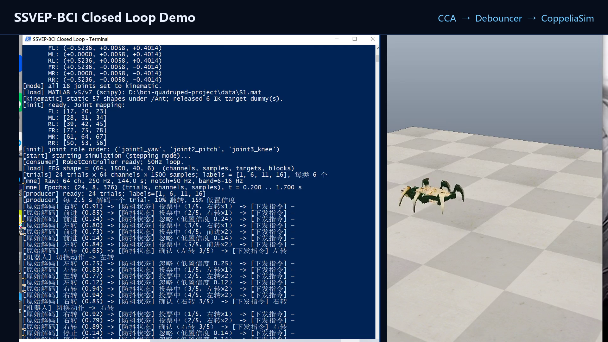
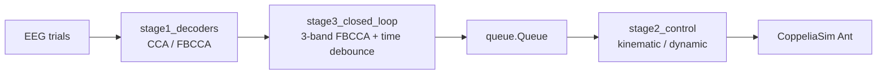

⚠️ 这是 V2.0 开发分支。若需查看稳定版（V1.0），请切换至主目录或 v1.0 分支。

# BCI-Quadruped V2.0 开发分支

> V1.0 稳定目录：`D:\bci-quadruped-project`  
> V2.0 开发目录：`D:\bci-quadruped-v2.0-dev`

## V2.0 目标

V2.0 在 V1.0 的可运行闭环基础上继续升级：

- Stage 1：从 CCA 扩展到 **FBCCA（Filter Bank CCA）**，对比准确率与耗时；
- Stage 2：从纯运动学步态扩展到 **物理引擎动力学步态**；
- Stage 3：保持 CCA/FBCCA → 时间窗防抖 → 50 Hz 控制的流式闭环；
- 工程：保持模块边界清晰，方便并行实验，不污染 V1.0 稳定版。

## 目录

```text
bci-quadruped-v2.0-dev/
├─ data/                         # 从 V1.0 完整复制
├─ scenes/                       # 从 V1.0 完整复制
├─ docs/                         # 从 V1.0 完整复制
│  └─ v1.0_manual.md             # V1.0 GUIDANCE 历史副本
├─ tests/                        # 从 V1.0 完整复制
├─ src/
│  ├─ stage1_decoders/
│  │  ├─ cca_decoder.py          # V1.0 CCA，路径已适配新目录
│  │  ├─ fbcca_decoder.py        # V2.0 FBCCA（3/5 子带 + 权重模式）
│  │  └─ compare_acc.py          # CCA vs FBCCA 准确率/耗时对比
│  ├─ stage2_control/
│  │  ├─ kinematic_gait.py       # V1.0 运动学步态
│  │  └─ dynamic_gait.py         # V2.0 待实现
│  └─ stage3_closed_loop/
│     ├─ step3_closed_loop.py    # 1.5 s trial 级闭环
│     └─ streaming_loop.py       # 250 Hz 流式滑动窗口闭环
└─ README.md
```

## 当前状态

- [x] 物理隔离：V1.0 原目录不修改
- [x] data/scenes/docs/tests 完整复制
- [x] src 目录按 stage1/stage2/stage3 重构
- [x] stage3 import 适配新目录
- [x] FBCCA 实现（5 子带 + 标准权重）
- [x] 3 子带消融 + low-weight 权重实验
- [x] CCA vs FBCCA 准确率/耗时对比
- [x] 250 Hz 流式滑动窗口（3-band FBCCA + 时间防抖）
- [ ] 动力学步态
- [ ] V2.0 闭环 Demo

## 快速检查

```powershell
cd D:\bci-quadruped-v2.0-dev
conda activate bci-quadruped

# 语法检查
python -m py_compile `
  src\stage1_decoders\cca_decoder.py `
  src\stage2_control\kinematic_gait.py `
  src\stage3_closed_loop\step3_closed_loop.py `
  src\stage3_closed_loop\streaming_loop.py

# Stage 1：CCA / FBCCA / 对比
python src\stage1_decoders\cca_decoder.py
python src\stage1_decoders\fbcca_decoder.py
python src\stage1_decoders\compare_acc.py

# Stage 2：只读检查 / 站立 / 5 步
python src\stage2_control\kinematic_gait.py --inspect
python src\stage2_control\kinematic_gait.py --stand-only
python src\stage2_control\kinematic_gait.py --walk-steps 5

# Stage 3：1.5 s trial 级闭环 dry-run
python src\stage3_closed_loop\step3_closed_loop.py --dry-run --max-seconds 20

# Stage 3：250 Hz 流式滑动窗口
python src\stage3_closed_loop\streaming_loop.py --dry-run --max-seconds 20
python src\stage3_closed_loop\streaming_loop.py --max-seconds 60
```

> Stage 1/2/3 的完整说明见 `docs/v1.0_manual.md`（V1.0 历史手册）
> 以及 `docs/ant_manual.md`（Ant 调试手册）。

## 消融实验与算法权衡

核心三组对照：**CCA、FBCCA 5-band、FBCCA 3-band**；额外保留
low-weight 5-band 作为权重消融。本机、S1 + S2 共 48 trial 实测
（预测耗时已排除 warm-up）：

| Method | Accuracy | Correct/Total | Avg prediction/trial | Total prediction |
|---|---:|---:|---:|---:|
| CCA | 97.92% | 47/48 | 6.12 ms | 0.2937 s |
| FBCCA (5 bands, standard) | 95.83% | 46/48 | 30.79 ms | 1.4781 s |
| **FBCCA (3 bands)** | **100.00%** | **48/48** | **18.81 ms** | **0.9028 s** |
| FBCCA (5 bands, low-weight) | 97.92% | 47/48 | 30.77 ms | 1.4769 s |

分被试：

| Method | S1 | S2 |
|---|---:|---:|
| CCA | 100.00% | 95.83% |
| FBCCA (5 bands, standard) | 100.00% | 91.67% |
| FBCCA (3 bands) | 100.00% | 100.00% |
| FBCCA (5 bands, low-weight) | 100.00% | 95.83% |

3-band FBCCA 的预测耗时约为 CCA 的 **3.07×**，5-band 约为 **5.03×**。
混淆矩阵输出：

```text
docs/step_0.analysis/fbcca_confusion_matrix.png              # 5-band
docs/step_0.analysis/fbcca_confusion_matrix_3bands_standard.png  # 3-band
```

本次实验的结论不是“FBCCA 一定优于 CCA”，而是：

> 子带数量和权重必须由数据信噪比决定；在该数据上，砍掉最高频子带比继续加带更能提升 S2。

---

**核心结论：高频子带引入噪声。** 38–90 Hz、30–90 Hz 子带对 8–15.2 Hz
SSVEP 基频贡献很小，却会把 EMG、电极接触噪声和运动伪迹带进 CCA；
S2 对高频噪声尤其敏感，所以 3-band 反而从 95.83% 回到 100%。

### 现象

标准 5 带 FBCCA：

```text
sub-bands = (6,90), (14,90), (22,90), (30,90), (38,90)
weights   = 1.25, 0.670, 0.503, 0.427, 0.383
overall   = 95.83%  (46/48)
S2        = 91.67%  (22/24)
```

去掉最高两个子带，只保留 3 带：

```text
sub-bands = (6,90), (14,90), (22,90)
overall   = 100.00% (48/48)
S2        = 100.00% (24/24)
time      = 3.07× CCA
```

### 工程解释

1. **“更多子带”不等于“更多信息”**
   - 6–90 Hz 的宽频带里既有 SSVEP 的 2/3 次谐波，也有肌电（EMG）、电极接触噪声、工频残余和运动伪迹；
   - 38–90 Hz、30–90 Hz 这些高频子带对 8–15.2 Hz 的 SSVEP 基频贡献很小，却会把高频噪声送进 CCA；
   - CCA 对噪声敏感，单个子带的错误相关峰值会通过加权和污染最终得分。

2. **S2 的高频谐波信噪比更低**
   - 两个被试的头皮阻抗、枕区电极接触和 alpha 活动不同；
   - S2 在 22–90 Hz 高频段的信噪比不足以支撑第 4/5 子带的“额外证据”；
   - 标准权重虽然给高频较低权重，但 5 个带仍然让 S2 从 24/24 掉到 22/24。

3. **低频权重可以缓解，但不能修复坏子带**
   - low-weight 5 带把 S2 从 91.67% 拉回 95.83%，说明高频权重确实过大；
   - 但没有回到 100%，因为坏子带仍在参与融合；
   - 直接删掉最高频子带（3 带）比“保留坏子带 + 调小权重”更干净。

4. **耗时与收益不成正比**
   - 5 带约 5.03× CCA，3 带约 3.07× CCA；
   - 3 带同时取得更高准确率和更低延迟，是当前数据上的 Pareto 更优点。

### V2.0 的决策

- `fbcca_decoder.py` 默认仍保留标准 5 带，作为可复现基线；
- 提供 `--bands 3` 和 `--weight-mode low` 做消融；
- low-weight 5 带权重：`(2.0, 1.0, 0.5, 0.25, 0.15)`；
- `compare_acc.py` 固定输出 CCA、5 带标准、3 带、5 带低权重四组结果；
- 当前数据集的推荐配置：**3 带 + 标准权重**；
- 后续应做 **按被试/按 session 的子带选择**，而不是在全体 48 trial 上硬调一个全局权重；
- 48 trial 的 100% 只代表当前小样本，不能当成泛化精度；需要更多被试/更多 block 验证。

> 工程结论：FBCCA 的“filter bank”不是越多越好。子带是假设，不是免费特征；
> 每个子带都要用验证集证明它带来的信息增益大于噪声增益。

## 实时流式架构设计

V2.0 的实时链路不是“离线切 trial”，而是模拟真实采集设备的连续流：

```mermaid
flowchart LR
    A["流数据<br/>250 Hz / 10 samples per packet"] --> B["Ring Buffer<br/>deque(maxlen=375)<br/>1.5 s"]
    B --> C["Snapshot Queue<br/>maxsize=1<br/>latest window only"]
    C --> D["Decode Thread<br/>3-band FBCCA<br/>notch + 3 sub-bands"]
    D --> E["Time Debouncer<br/>1000 ms window<br/>>60% + avg conf >0.3"]
    E --> F["Command Queue<br/>confirmed commands"]
    F --> G["Consumer Thread<br/>50 Hz"]
    G --> H["RobotController<br/>stand / forward / turn / stop"]
    H --> I["CoppeliaSim Ant"]
```



`src/stage3_closed_loop/streaming_loop.py` 不再按 trial 离线切片，而是模拟真实设备：

```text
S1.mat 连续 Raw（24 trial 拼接）
  → 每 40 ms 推入 10 个采样点（250 Hz 等效）
  → deque(maxlen=375)  最近 1.5 s
  → 每 200 ms 取最近 375 点
  → scipy 实时 50 Hz notch + 3-band 滤波
  → 3-band FBCCA → (label, confidence)
  → 1000 ms 时间窗防抖（>60% + 平均置信度>0.3）
  → queue.Queue
  → 50 Hz Consumer → RobotController
```

关键设计：

- **三线程**：stream / decode / consumer；滤波和 CCA 绝不占用 50 Hz 控制线程；
- **有界队列**：解码慢时丢弃旧窗口，只保留最新快照；
- **实时滤波**：`scipy.signal.filtfilt` + `sosfiltfilt`，每个窗口 3 个子带；
- **时间防抖**：最近 1000 ms 内同标签占比 >60%，且该标签平均置信度 >0.3；
- **启动保护**：至少 5 个有效窗口才允许确认，避免“第一帧 100%”；
- **冷却**：确认后锁定 1.5 s；
- **暖机**：正式流开始前先跑一次 `decode_window`，避免 sklearn 首次调用
  的 1~2 s 延迟污染实时指标。

实测 dry-run 的滤波 + 3-band CCA 单窗口约 **20–25 ms**，远小于 200 ms 决策周期，
不会阻塞 50 Hz Consumer。

运行：

```powershell
python src\stage3_closed_loop\streaming_loop.py --dry-run --max-seconds 20
python src\stage3_closed_loop\streaming_loop.py --max-seconds 60
```

## Demo 演示

> **待插入：V2.0 实时流式 Demo 视频 / GIF。**
>
> 建议录制分屏：左侧终端实时打印
> `[流式解码] ... -> [时间防抖] ... -> [下发] ...`，
> 右侧 CoppeliaSim 展示 Ant 执行 `forward / turn_left / turn_right / stop`。
> 上传后把下面的占位替换成视频链接或 GIF 即可。

| 内容 | 状态 |
|---|---|
| V2.0 实时流式 Demo 视频 | 待插入 |
| V2.0 实时流式 Demo GIF | 待插入 |
| V1.0 参考 Demo | step3_closed_loop_demo.mp4（视频已归档，见 B 站） |

<!--
上传后示例：
[](step_4.demo/step3_closed_loop_demo.mp4)
-->

## V1.0 稳定版

本目录中的 `data/`、`scenes/`、`docs/`、`tests/` 以及 `src/stage1_decoders/cca_decoder.py`、
`src/stage2_control/kinematic_gait.py` 都来自 V1.0 的复制件。

如果 V2 实验失败，直接回到：

```text
D:\bci-quadruped-project
```

V1.0 的文件没有被修改、覆盖或删除。

## 总体架构（模块视角）


